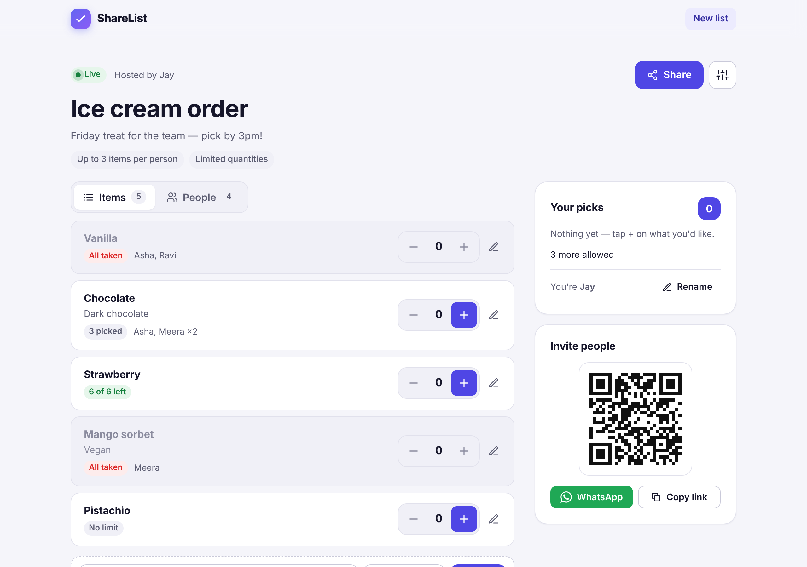
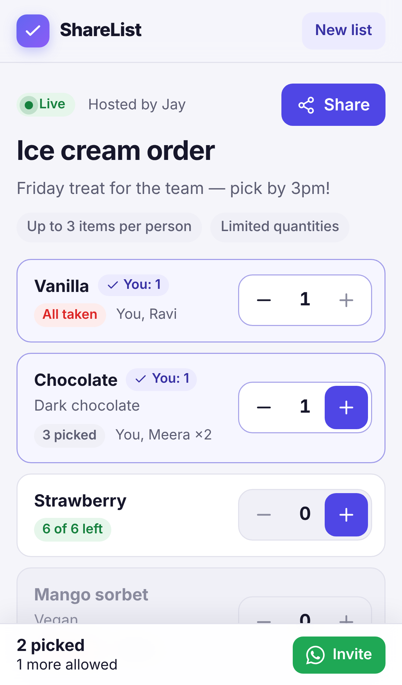
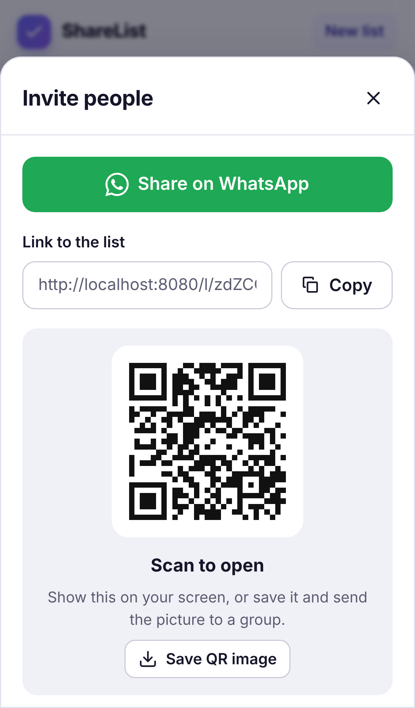

# ShareList — real-time collaborative lists

Make a list, share it on WhatsApp (link or QR code), and watch everyone pick in real time.
The host can limit how many of each item exist and how many things each person may take.
When something runs out, it is disabled for everyone instantly.

**Example:** Jay creates an *Ice cream order* list with a few flavours and only **2 vanilla**.
Asha takes one vanilla, and everyone else's screen immediately shows **"Only 1 left"**. Ravi
takes the last one, so vanilla shows **"All taken"** and its **+** button is disabled for
everyone. If Ravi gives his back, it reappears.

| Host on a laptop | Guest on a phone | Sharing |
| --- | --- | --- |
|  |  |  |

## Features

- **Lists with optional quantities.** Each item can have a limited quantity (e.g. vanilla × 2),
  or no limit. Leave the quantity empty for unlimited.
- **Item counts.** Let people take several of the same item (− / + buttons), or switch it off
  for a simple tick list ("Pick" button).
- **Max per person.** No limit, exactly 1, or any number, counted across the whole list.
- **Live updates.** Every change is pushed to everyone with the list open (Server-Sent
  Events). Items someone else just changed briefly highlight.
- **No oversell, even under contention.** Limits are enforced on the server inside a database
  transaction with a row lock. A test fires 24 simultaneous requests at a flavour limited to 2:
  exactly 2 succeed.
- **Share anywhere.** One-tap WhatsApp share, the phone's native share sheet, a copyable link,
  and a QR code you can show on screen or save and send as an image.
- **No sign-up.** Guests just type their name. The host gets a private link to manage the list
  from another device.
- **Host tools.** Edit, reorder, add or remove items; see who picked what; remove someone;
  copy or WhatsApp a summary; hide picks from guests; close the list to freeze picks; delete it.
- **Works on every screen size.** Phone (bottom summary bar and bottom sheets), tablet and
  desktop (two-column layout), with light and dark mode.

## Tech stack

| Layer | Choice |
| --- | --- |
| Backend | **Java 25** (current LTS), **Spring Boot 4.2** (Spring MVC on virtual threads, Spring Data JPA / Hibernate 7, Bean Validation) |
| Database | **PostgreSQL 18**, schema managed with **Flyway** |
| Real time | Server-Sent Events (`text/event-stream`) |
| Frontend | **Angular 22**: standalone components, signals, zoneless change detection, Signal Forms |
| Tests | JUnit 5 + Testcontainers (real PostgreSQL), Vitest, Playwright smoke tests |

## Running it

### Option 1: everything in Docker

```bash
docker compose up --build
```

Open <http://localhost:8080>. This starts PostgreSQL and the app; the Spring Boot server also
serves the Angular UI.

### Option 2: development mode (hot reload)

Prerequisites: JDK 25, Node.js 22.22+ or 24+, Docker.

```bash
# Terminal 1: API on :8080. A throwaway PostgreSQL container starts automatically.
cd backend
./mvnw spring-boot:test-run

# Terminal 2: UI on :4200, proxying /api to :8080
cd frontend
npm install
npm start
```

Open <http://localhost:4200>.

To keep data between restarts, start PostgreSQL with `docker compose up db` and run
`./mvnw spring-boot:run` instead of `spring-boot:test-run`.

### Option 3: a single jar

```bash
cd backend
./mvnw package -Pwith-frontend      # builds the Angular app and bundles it into the jar
java -jar target/sharelist-api-0.1.0-SNAPSHOT.jar
```

The jar expects PostgreSQL at `localhost:5432` (database, user and password `sharelist`).
Point it elsewhere with environment variables (see below).

> Phones on your Wi-Fi can open the app at `http://<your-computer-ip>:8080`. Copying to the
> clipboard and the native share sheet need HTTPS (or localhost), so deploy behind TLS for
> real use.

## Tests

```bash
cd backend && ./mvnw verify                  # unit and integration tests (needs Docker for Testcontainers)
cd frontend && npm test -- --watch=false     # Vitest unit tests
cd e2e && npm install && npx playwright install chromium && npm test   # against a running app on :8080
```

The backend suite covers the list flows over HTTP against a real PostgreSQL: limits, the
per-person cap, one-of-each mode, private picks, host-only actions, closing and deleting, and
validation. It also covers concurrent claims on the last units and the live event stream. The
e2e scripts drive a host and two guests on different device sizes at the same time.

## Configuration

Spring Boot maps environment variables onto settings, e.g. `SPRING_DATASOURCE_URL`.

| Variable | Default | Meaning |
| --- | --- | --- |
| `SPRING_DATASOURCE_URL` | `jdbc:postgresql://localhost:5432/sharelist` | Database URL |
| `SPRING_DATASOURCE_USERNAME` / `SPRING_DATASOURCE_PASSWORD` | `sharelist` / `sharelist` | Database credentials |
| `APP_LIMITS_MAX_ITEMS_PER_LIST` | `200` | Items per list |
| `APP_LIMITS_MAX_PARTICIPANTS_PER_LIST` | `500` | People per list |
| `APP_REALTIME_EMITTER_TIMEOUT` | `15m` | Event streams are recycled after this; browsers reconnect automatically |
| `APP_REALTIME_HEARTBEAT_INTERVAL` | `20s` | Keep-alive comments so proxies don't drop idle streams |
| `APP_RETENTION_ENABLED` / `APP_RETENTION_DELETE_INACTIVE_AFTER` | `true` / `180d` | Delete lists untouched for this long (checked daily) |
| `APP_CORS_ALLOWED_ORIGINS` | *(empty)* | Only needed if the UI is hosted on a different origin than the API |

## How it works

```
 Browser (Angular)                         Spring Boot                       PostgreSQL
 ─────────────────                         ───────────                       ──────────
 PUT /items/7/claim {quantity: 2} ───────▶ lock list row (SELECT … FOR UPDATE)
                                           check stock + per-person limit
                                           write claim, revision++  ─────────▶ COMMIT
 ◀─────────────── updated list (rev 42) ── after commit: publish "rev 42"
 everyone's EventSource ◀──── event: revision {"revision":42}
 GET /lists/{slug} (own token) ──────────▶ personalised view (my picks, what's left)
```

- **Identity without accounts.** Creating or joining returns a random 256-bit token. The
  browser stores it in `localStorage` and sends it as `X-Participant-Token`; the server only
  stores its SHA-256 hash. Share links contain only the public list code
  (`/l/k3J9xP2aQr`). Private "use on another device" links put the token in the URL fragment
  (`#t=…`), which browsers never send to servers.
- **Correctness under concurrency.** Every write to a list first row-locks that list, so the
  availability check and the write can't interleave with another person's. Different lists
  never block each other. Lowering a limit below what's already taken is rejected; giving
  things back is always allowed.
- **Real-time.** Each change bumps the list's `revision` and, after the transaction commits,
  pushes a tiny `revision` event to every open stream for that list. Each client then
  re-fetches its own view, so privacy rules (e.g. hiding who picked what) live in one place.
  On reconnect the stream starts with the current revision, so missed updates are caught up.
  The UI applies taps optimistically and merges rapid taps into a single request.
- **Scaling note.** Open streams are tracked in memory, which is right for a single instance.
  To run several instances behind a load balancer, relay the events between them, e.g. with
  PostgreSQL `LISTEN/NOTIFY` (the hook is `ListEventHub`). If you deploy behind nginx, the
  stream already sends `X-Accel-Buffering: no`; make sure proxy read timeouts exceed the 20s
  heartbeat.

## Before going to production

- Serve it over **HTTPS** (needed for copy-to-clipboard and the native share sheet on phones).
- Add **rate limiting** at your reverse proxy or gateway; the app itself caps list sizes but
  doesn't throttle requests.
- Back up the PostgreSQL volume; set a real `POSTGRES_PASSWORD` for Docker Compose.

## API

All endpoints are under `/api/lists`. Errors use RFC 9457 problem details with a
machine-readable `code` (e.g. `NOT_ENOUGH_LEFT`, `PERSON_LIMIT_REACHED`, `LIST_CLOSED`) and a
human-readable `detail`.

| Method & path | Who | What |
| --- | --- | --- |
| `POST /api/lists` | anyone | Create a list; returns the host's token and the list |
| `GET /api/lists/{slug}` | anyone | The list as seen by the caller (token optional) |
| `GET /api/lists/{slug}/events` | anyone | Server-Sent Events: `revision`, `deleted` |
| `POST /api/lists/{slug}/participants` | anyone | Join with a display name; returns a token |
| `PATCH /api/lists/{slug}/participants/me` | participant | Change your name |
| `DELETE /api/lists/{slug}/participants/me` | participant | Leave (gives back your picks) |
| `PUT /api/lists/{slug}/items/{id}/claim` | participant | Set how many of an item you hold (`{"quantity": 2}`, `0` gives all back) |
| `PUT /api/lists/{slug}` | host | Title, description, rules, close/reopen |
| `POST /api/lists/{slug}/items` | host | Add an item |
| `PUT /api/lists/{slug}/items/{id}` | host | Edit name, note, quantity |
| `DELETE /api/lists/{slug}/items/{id}` | host | Remove an item |
| `PUT /api/lists/{slug}/item-order` | host | Reorder items |
| `DELETE /api/lists/{slug}/participants/{id}` | host | Remove someone (gives back their picks) |
| `DELETE /api/lists/{slug}` | host | Delete the list |

## Project layout

```
backend/    Spring Boot API (com.sharelist)
  list/       entities, rules (ClaimRules), service, REST controller
  realtime/   Server-Sent Events hub and endpoint
  config/     web config (SPA fallback, CORS, caching), properties
  resources/db/migration/   Flyway SQL migrations
frontend/   Angular app
  core/       API client, identity (tokens), toasts, share helpers
  pages/      home, create list, list page (store, item rows, dialogs)
e2e/        Playwright smoke tests (multiple people on different devices)
```
